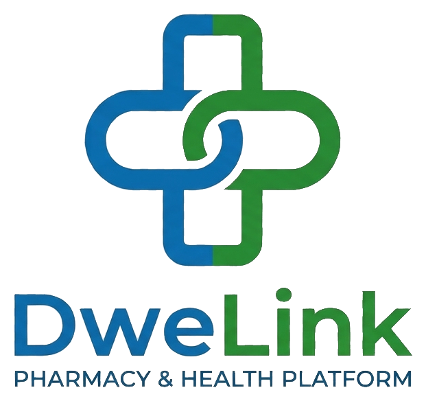

<p align="center">
  
</p>

<h1 align="center">DweLink</h1>

<p align="center"><b>Le lien entre patients, donateurs et pharmacies.</b></p>

<p align="center">
Projet du module <b>Architecture Web Distribuée (AWD)</b> – classe 4DAS13, groupe 6 – 2026-2027
</p>

---

## Sujet

DweLink est une plateforme qui permet :

- aux **patients** de rechercher un médicament, de trouver une pharmacie qui l'a et de le réserver ;
- aux **pharmaciens** de gérer leur pharmacie, leur stock et leurs réservations ;
- aux **donateurs** de donner leurs médicaments inutilisés à des pharmacies partenaires ;
- aux **administrateurs** de valider les pharmaciens et les pharmacies, et de gérer le catalogue.

## Équipe et microservices

| # | Microservice | Responsable |
|---|---|---|
| 01 | Gestion des utilisateurs et des inscriptions | Hichem Jemaiel |
| 02 | Gestion des pharmacies | Mohamed Yassine Ben Aïssa |
| 03 | Catalogue des médicaments | Wejdene Bouali |
| 04 | Gestion du stock et des alertes | Rayen Sassi |
| 05 | Gestion des réservations | Roua Selmi |
| 06 | Dons et solidarité | Mohamed Yassine Azzouz |
| 07 | Gestion des notifications (microservice commun) | Toute l'équipe |

## Technologies

Angular · Spring Boot · Spring Cloud (Gateway, Eureka, Config Server) · Keycloak · RabbitMQ · PostgreSQL · MongoDB · Docker

## Structure du dépôt

```
DweLink-4das13-g6/
├── Backend/                      un dossier par microservice Spring Boot
│   ├── user-service/
│   ├── pharmacy-service/
│   ├── catalog-service/
│   ├── inventory-service/
│   ├── reservation-service/
│   ├── donation-service/
│   └── notification-service/
├── Frontend/                     application Angular
├── Documentation/
│   ├── Presentation/
│   │   ├── DweLink_Presentation.pdf
│   │   └── DweLink_Rapport.pdf
│   ├── Diagrams/                 diagrammes de classes (01 à 07)
│   └── logo.png
├── .gitignore
└── README.md
```

## Documentation

- **Rapport de conception** : [DweLink_Rapport.pdf](Documentation/Presentation/DweLink_Rapport.pdf)
- **Présentation** : [DweLink_Presentation.pdf](Documentation/Presentation/DweLink_Presentation.pdf)
- **Diagrammes de classes** : [Documentation/Diagrams](Documentation/Diagrams)

## Organisation

- Une branche par microservice : `feature/<nom>-service` (exemple : `feature/pharmacy-service`).
- Fusion dans `main` par pull request, après relecture.
- Messages de commit clairs, en français (exemple : `feat(pharmacy): ajout de l'entité Pharmacie`).
- Les fichiers d'IDE (`.idea/`, `.vscode/`), les dossiers `target/` et `node_modules/` ne sont pas envoyés (voir `.gitignore`).
- Suivi des tâches avec GitHub Projects.

## Lancement

À venir : le projet est en phase de conception. Commande prévue :

```bash
docker compose up
```
