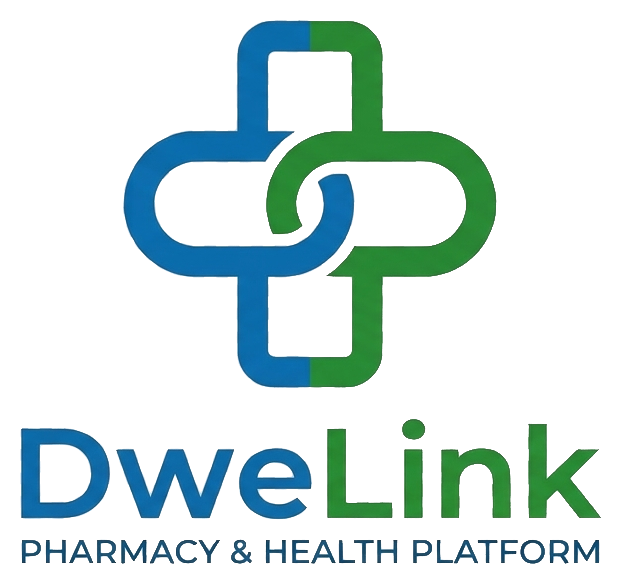

<p align="center">
  
</p>

<h1 align="center">DweLink</h1>

<p align="center"><b>Le lien entre patients, donateurs et pharmacies.</b></p>

<p align="center">
Projet du module <b>Architecture Web Distribuée (AWD)</b> – classe 4DAS13, groupe 6 – 2026-2027
</p>

---

## Sujet

DweLink est une plateforme qui permet :

- aux **patients** de rechercher un médicament, de trouver une pharmacie qui l'a et de le réserver ;
- aux **pharmaciens** de gérer leur pharmacie, leur stock et leurs réservations ;
- aux **donateurs** de donner leurs médicaments inutilisés à des pharmacies partenaires ;
- aux **administrateurs** de valider les pharmaciens et les pharmacies, et de gérer le catalogue.

## Équipe et microservices

| # | Microservice | Responsable |
|---|---|---|
| 01 | Gestion des utilisateurs et des inscriptions | Hichem Jemaiel |
| 02 | Gestion des pharmacies | Mohamed Yassine Ben Aïssa |
| 03 | Catalogue des médicaments | Wejdene Bouali |
| 04 | Gestion du stock et des alertes | Rayen Sassi |
| 05 | Gestion des réservations | Roua Selmi |
| 06 | Dons et solidarité | Mohamed Yassine Azzouz |
| 07 | Gestion des notifications (microservice commun) | Toute l'équipe |

## Technologies

Angular · Spring Boot · Spring Cloud (Gateway, Eureka, Config Server) · Keycloak · RabbitMQ · PostgreSQL · MongoDB · Docker

## Structure du dépôt

```
DweLink-4das13-g6/
├── Backend/              microservices Spring Boot
├── Frontend/             application Angular
├── Documentation/
│   ├── Presentation/     présentation de la séance 4
│   ├── Diagrams/         diagramme d'architecture et diagrammes UML
│   └── logo.png
└── README.md
```

## Organisation

- Une branche par fonctionnalité, fusion par pull request.
- Suivi des tâches avec GitHub Projects.
